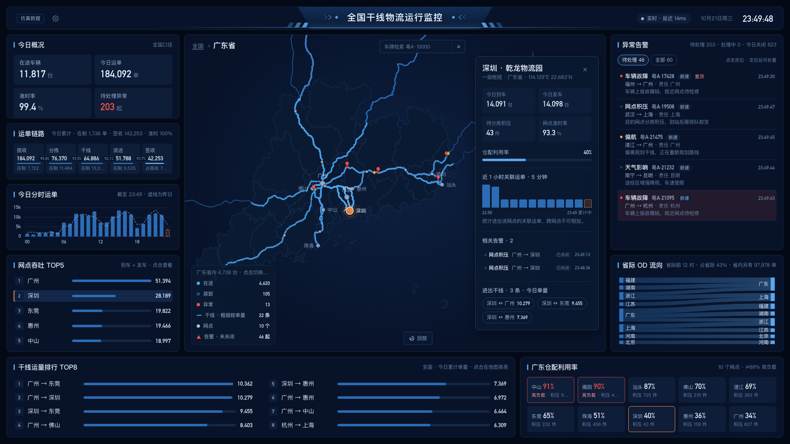

# 智慧物流数据可视化大屏

全国物流干线网的实时监控大屏：中央地图（全国 / 广东下钻）同屏渲染 **12,000 台车辆**的实时位置，配合运单趋势、网点吞吐、实时异常事件流、时效分布、仓配概览与干线运量排行，数据由同仓的模拟引擎以 1 秒节拍通过 WebSocket 持续推送。

> **关于数据（请先读）**：本项目为**个人项目**，没有真实业务数据。页面上的车辆、运单、异常事件均由 `server/` 里的**自研模拟引擎生成的仿真数据**（车辆沿干线插值移动、状态机、概率异常事件）。架构、渲染与实时链路都是真实实现；把它当作可视化与实时数据处理能力的演示，不要当作真实运营系统。




## 快速启动

环境：Node.js 20+（开发时为 v24）。

```bash
npm run install:all   # 安装 client 与 server 依赖（首次）
npm run dev           # 一键启动：模拟引擎 http://localhost:8787 + 前端 http://localhost:5173
```

浏览器打开 http://localhost:5173 即可。也可以分开启动：`npm run dev:server` / `npm run dev:client`。

生产构建：`npm run build`（产物在 `client/dist/`）。同域网关部署时将 `/api`、`/ws` 转发到引擎即可；前后端分域部署时可在构建前设置 `VITE_API_BASE` 与 `VITE_WS_URL`。

操作：点击地图上的**广东省**下钻到省视图（左上角按钮返回全国）；点击任意**网点**弹出详情浮层；点击左列「网点吞吐 TOP5」或右列「广东仓配概览」里的网点也可切换详情；右上角按钮或按 `H` 开关性能 HUD。

HUD 默认关闭，保存上次手动选择；URL 加 `?hud=1` 可强制开启，`?hud=0` 强制关闭。按 `Esc` 或点击地图空白处关闭网点详情。异常列表按严重程度优先显示，点击事件可定位目的网点；仓配概览宽屏展示利用率 TOP8，紧凑布局展示 TOP5，并标明全省网点总数与高负载阈值（≥88%）。

趋势图口径为北京时间「今日分时」：已过小时显示仿真基线，当前小时以虚线表示累计中，未来小时留空，跨日重置。今日运单 KPI 与分时累计之和一致。广东下钻按 GeoJSON 多边形精确过滤车辆（含岛屿及内环），纬度索引用于减少边界查询开销；全国仅常驻显示一级枢纽标签。

`docs/` 中的截图与下方性能数字是改版前的历史记录；本轮调整了车辆点大小、流线和边界过滤，当前版本性能需在目标硬件上重新采样，不能直接沿用历史数字作为本轮结果。

## 技术栈

- 前端：Vue 3 + TypeScript + Vite + ECharts 5 + Pinia
- 模拟引擎：Node.js + `ws`（无框架，HTTP 快照 + WebSocket 推送同端口）
- 地图：ECharts geo + GeoJSON（阿里 DataV 公开数据，全国与广东省界已下载到 `client/src/assets/geo/` 打包进仓库，离线可跑，不依赖任何地图厂商 key）

## UI 规范与适配

- 设计变量统一在 `client/src/design/tokens.ts` 定义，应用启动时安装 CSS 自定义属性；DOM 和 ECharts 共用颜色、字体，Tooltip 使用统一配置。主要间距为 8/16/24/32px，细节允许 4/12px；面板圆角 8px，控件圆角 4px。
- 正文 14px、辅助文字和图表轴标签 12px、面板标题 16px、页面标题 24px（紧凑布局 20px）、KPI 36px；数字使用等宽数字。采用真实尺寸的响应式布局，不再通过整体 transform 缩小文字。1920×1080、1440×900 为主要验收尺寸；较窄屏幕改成纵向布局，空间不足时允许滚动。
- 按钮与交互列表行至少 32px 高，按钮至少 32px 宽，统一键盘焦点；仓配利用率同时显示「正常/高负载」文字，不单靠颜色表示告警。
- 首批有效数据前，KPI 显示 `—`，面板显示加载或失败占位；请求失败原因在页面直接展示。断线、消息解析错误或超过 5 秒未收到有效更新时展示「数据已过期」，保留最后有效数据；有效更新到达后自动恢复。
- 顶栏可关闭装饰动效；系统启用 `prefers-reduced-motion` 时自动禁用 CSS 和 ECharts 动画、流线特效及网点涟漪，继续接收和展示实时位置。布局变化由 ResizeObserver 通知图表重排。
- 趋势 Tooltip 根据原始时间桶展示唯一数值，区分已完成小时、当前小时累计和暂无数据，避免虚线连接点产生重复描述。

设计依据：[Ant Design 布局](https://ant.design/docs/spec/layout-cn/)、[字体](https://ant.design/docs/spec/font-cn/)、[WCAG 对比度](https://www.w3.org/WAI/WCAG22/Understanding/contrast-minimum)、[颜色使用](https://www.w3.org/WAI/WCAG22/Understanding/use-of-color.html)。这些是本项目的实现约定，不代表已经完成 WCAG 全项合规认证。

## 架构

```
┌──────────────────── server/ 模拟数据引擎 ────────────────────┐
│  network.js  网点(24) / 干线(35) 静态网络                     │
│  engine.js   12,000 台车辆仿真：干线贝塞尔插值移动            │
│              状态机 在途→装卸→换线，概率异常+事件生成         │
│              网点吞吐/积压/KPI/趋势 聚合统计                  │
│  index.js    步进 250ms；HTTP /snapshot 全量快照             │
│              每 1s 聚合广播一条 delta（扁平数组编码）         │
└──────────────────────────┬───────────────────────────────────┘
                 HTTP 快照 │ WebSocket 增量（1Hz）
┌──────────────────────────▼───────────────────────────────────┐
│  client/ 前端（Pinia 单一数据源）                             │
│  socket.ts   先拉快照再连 WS，断线自动重连 + 60s 快照兜底    │
│  dashboard   vehicles 扁平数组整包替换引用，版本计数驱动渲染 │
│  MapChart    geo 地图 + 干线流线 + 三状态车辆散点 + 网点     │
│              首屏分片渐进喂入，增量只替换散点 series 数据     │
│  其余面板    趋势/占比/时效（ECharts）+ 排行/事件流/仓配（DOM) │
│  Hud         rAF 实测 FPS / 帧耗时 / 包大小 / 推送延迟        │
└──────────────────────────────────────────────────────────────┘
```

数据协议要点：车辆位置不用对象数组，用扁平数组 `[lng, lat, status] × N` 编码（一包 36,000 个数）；客户端按状态拆成三组散点分别着色（在途橙 / 装卸灰蓝 / 异常红）。

## 性能实测记录

以下数字全部来自本仓库的 HUD 与独立 WebSocket 采样脚本，测试环境是**本开发 VM 上的无头 Chromium（chrome-headless-shell，SwiftShader 软件渲染、无 GPU）**，1920×1080。软件渲染的帧率明显低于真实显卡环境，**真机（带 GPU）帧率未测，留待真机测**，简历引用时请只用本节口径。

| 指标 | 实测值 | 备注 |
| --- | --- | --- |
| 同屏车辆点位 | 12,000 台 | 快照扁平数组长度 36,000，已由接口与 HUD 双向核对 |
| 全国视图 FPS | 17–44（三轮截图采样 25 / 44 / 17） | 软件渲染下波动大，取区间如实记录 |
| 广东下钻视图 FPS | 53（单轮采样） | 下钻后只渲染省内子集 |
| 平均帧耗时 | 18.8–57.4 ms（随视图与采样时刻波动） | 与 FPS 采样对应 |
| WebSocket 增量包 | 平均约 223 KB / 秒（独立 ws 客户端连测 6 包，均值 223.2 KB） | 全量位置扁平数组 @1Hz，见「已知限制」 |
| 全量快照大小 | 约 229 KB | HTTP `/snapshot` 实测响应体 |
| 推送延迟 | 28–63 ms（采样） | 服务端时间戳到客户端接收，同机回环，仅供参考 |

为扛住万级点位与 1Hz 刷新所做的处理（都在代码里可查）：

1. 散点开启 ECharts `large` 大数据模式 + `progressive` 渐进渲染，首屏快照再按 4,000 / 8,000 / 12,000 **分片喂入**，避免一次性阻塞主线程；
2. 增量更新只 `setOption` 替换三组散点 series 的 `data`，从不重建整个图表 option；
3. 服务端 250ms 步进、**1s 聚合**成一包广播，客户端用 `requestAnimationFrame` 合并同一帧内的多次数据到达；
4. 位置用扁平数组编码而非对象数组，包体和解析开销都更低；
5. 干线流线动画做抽稀处理（线路点数固定、低频特效），不让装饰动画抢占散点渲染预算。

## 目录结构

```
.
├── 设计方案.md          # 立项时的设计方案（页面/技术/性能/验收标准）
├── package.json         # 根脚本：dev 一键启动、build、install:all
├── scripts/dev.mjs      # 同时拉起 server 与 client
├── server/              # 模拟数据引擎（Node + ws）
│   └── src/{index,engine,network}.js
├── client/              # 前端（Vue 3 + TS + Vite）
│   └── src/
│       ├── components/  # TopBar / MapChart / HubDetail / 各数据面板 / Hud
│       ├── stores/      # Pinia 数据中枢
│       ├── services/    # WebSocket 数据链路、ECharts 挂载钩子
│       ├── data/        # 前端侧网点/干线静态数据
│       └── assets/geo/  # 全国 + 广东 GeoJSON（已打包，离线可用）
└── docs/                # 验收截图（无头 Chromium 实拍，页面含真实渲染数据）
```

## 已知限制

- **增量包偏大**：当前 delta 是 12,000 台车的全量位置（约 223 KB/s），本地演示没问题，公网场景应改为「只发变化车辆 + 二进制编码」，本版未做，勿按现包体评估公网带宽。
- **慢客户端策略**：服务端默认在单连接待发送数据超过 1 MB 时跳过本轮 delta，避免慢客户端持续堆积内存；可用 `WS_MAX_BUFFERED_BYTES` 调整阈值。
- 坐标为城市级精度（网点落在城市中心点附近），不是真实站点地址；车辆轨迹是干线弧线插值，不是真实道路轨迹。
- 数据地址默认使用同域 `/api` 与 `/ws`；独立部署可设置 `VITE_API_BASE=https://api.example.com` 和 `VITE_WS_URL=wss://api.example.com/ws` 后重新构建。
- 帧率只在无 GPU 的无头环境测过（见上表），接真实大屏硬件后应重新采样再引用。

## 面试自问自答（节选）

- **为什么不用高德地图？** 大屏要的是行政区 choropleth + 自定义散点/流线，ECharts geo 离线可跑、无 key、风格可控；高德适合真实道路与 POI 场景，和这个需求不匹配。
- **万级点怎么扛？** large 模式走批量绘制、progressive 分帧渲染、首屏分片喂入、增量只换数据不换 option——四件事缺一件都会在某一帧卡住。
- **WebSocket 为什么要聚合？** 仿真步进是 250ms，但人眼看大屏不需要 4Hz 的位置刷新；聚合到 1Hz 把包数降到 1/4，代价是最高 1 秒的位置延迟，对监控大屏可接受。
