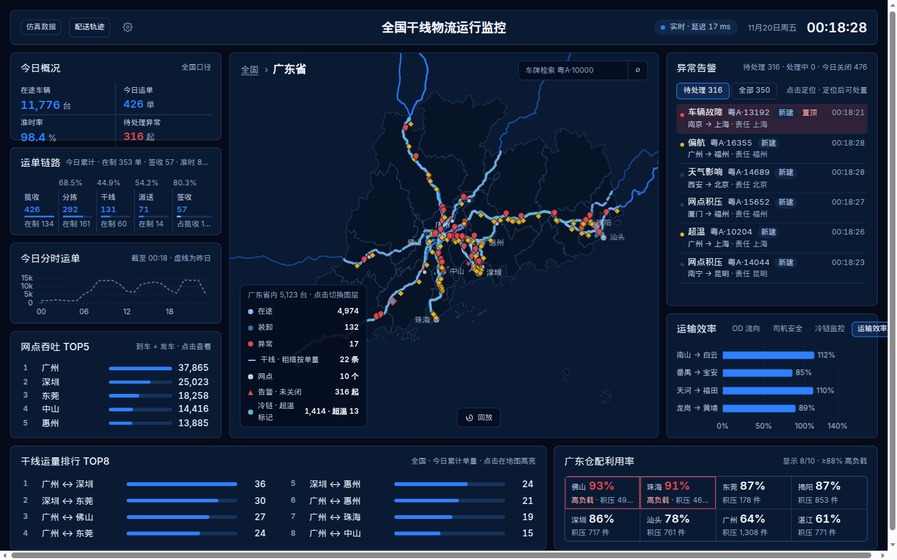
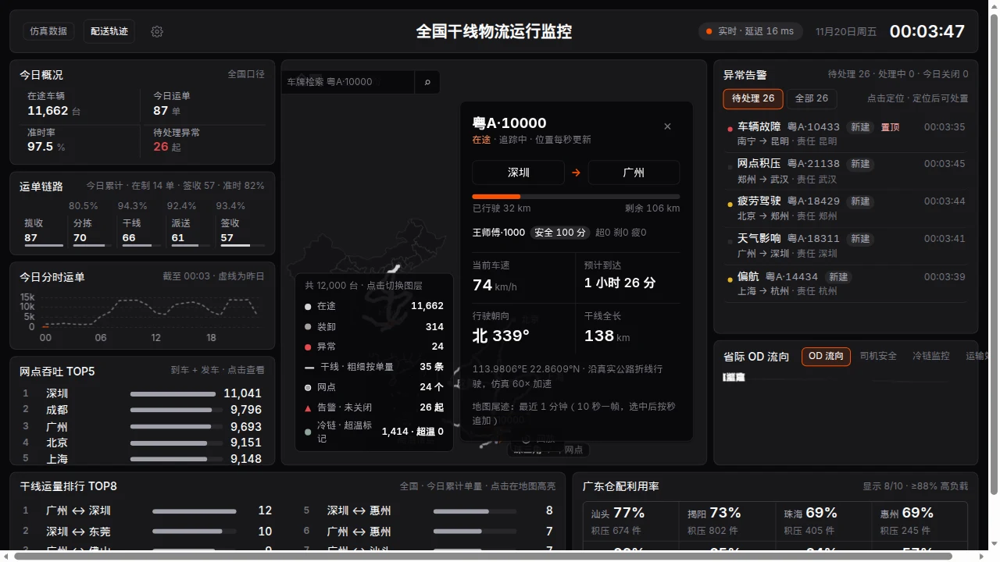
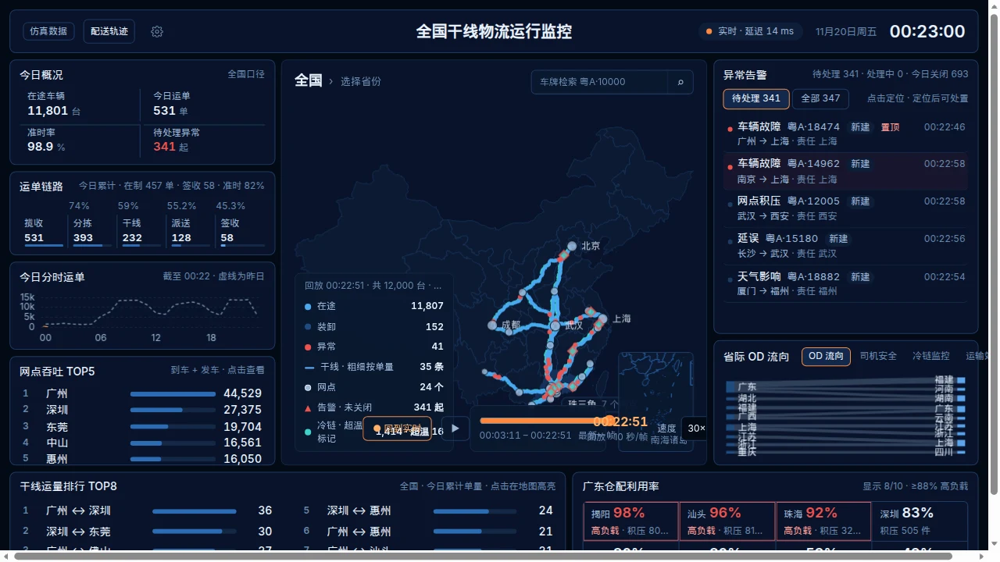
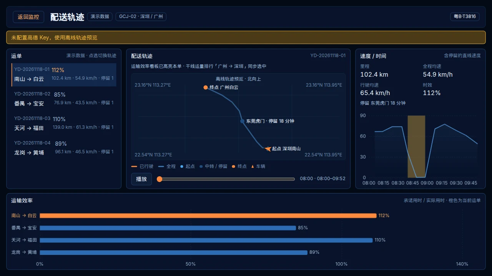
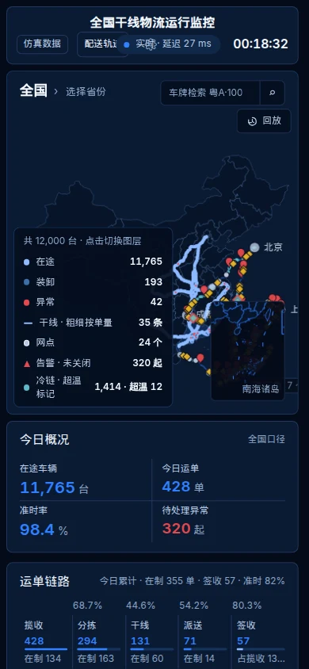

# 全国干线物流运行监控

个人作品里的物流运行大屏，给看代码的人用：地图上同时看车辆、网点和干线，两侧是今日运单、告警和仓配。数字来自仓库里的模拟引擎，用来演示实时可视化，不是某家公司的生产系统。




<table>
  <tr>
    <td width="400" align="center">
      
      <br>车牌追踪：车速、朝向和剩余里程
    </td>
    <td width="400" align="center">
      
      <br>回放：最近 1 小时的位置，10 秒一帧
    </td>
  </tr>
  <tr>
    <td width="400" align="center">
      
      <br>配送轨迹：没有高德 Key 时的离线预览
    </td>
    <td width="400" align="center">
      
      <br>窄屏：地图在上，指标收成 2×2
    </td>
  </tr>
</table>

## 功能

- 全国地图，以及任意省份下钻；干线按今日单量分级，图层可以单独开关
- 点击网点、车辆或干线打开详情；右上角按车牌检索，例如 `粤A·10000`
- 异常告警可以确认、开始处理或关闭，状态写回引擎，并同步到其他打开的页面
- 地图底部回放最近 1 小时的车辆位置，10 秒一帧
- 顶栏「配送轨迹」播放演示运单。配了 `VITE_AMAP_KEY` 用高德，否则用同一条折线做离线预览
- 冷链温度、司机安全评分，以及广东仓配利用率

## 技术栈

Vue 3、TypeScript、Vite、Pinia、ECharts 5。模拟引擎是 Node.js + `ws`，HTTP 快照和 WebSocket 走同一个端口。

## 实现上值得看的地方

- 约 12,000 台车的位置打成扁平数组，大约每秒一包。前端只换散点数据，不重建整张地图
- 干线折线由 OSRM 按公开路网离线算好，省界 GeoJSON 放在仓库里。全国图不需要地图厂商的 Key
- 告警有状态机，断线后按游标把漏掉的事件补回来。回放帧在引擎里环形保留 1 小时，打开时间轴再按需拉取
- `npm test` 跑引擎的 node:test，以及前端 Vitest（轨迹里程、停留、回放插值）

## 本地运行

需要 Node.js 20+。没有登录账号。

```bash
npm run install:all
npm run dev
```

浏览器打开 http://localhost:5173 。引擎默认听 http://localhost:8787 。

换端口时，`PORT` 和 `ENGINE_URL` 要指到同一处，否则页面仍去连 8787：

```bash
PORT=8788 ENGINE_URL=http://localhost:8788 npm run dev
```

高德 Key 不进仓库。复制 `client/.env.example` 为 `client/.env.local`，填写 `VITE_AMAP_KEY`。留空时配送轨迹走离线预览。

## 目录

- `client/` 大屏
- `server/` 模拟引擎
- `docs/` 上面的运行截图
