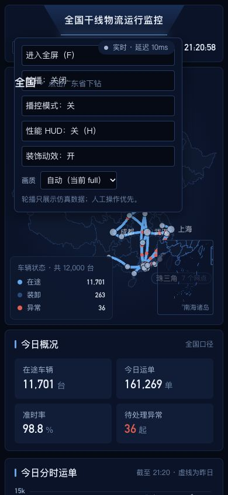
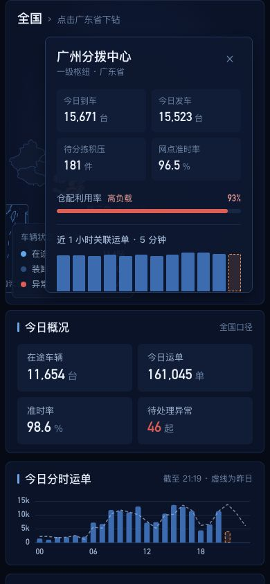
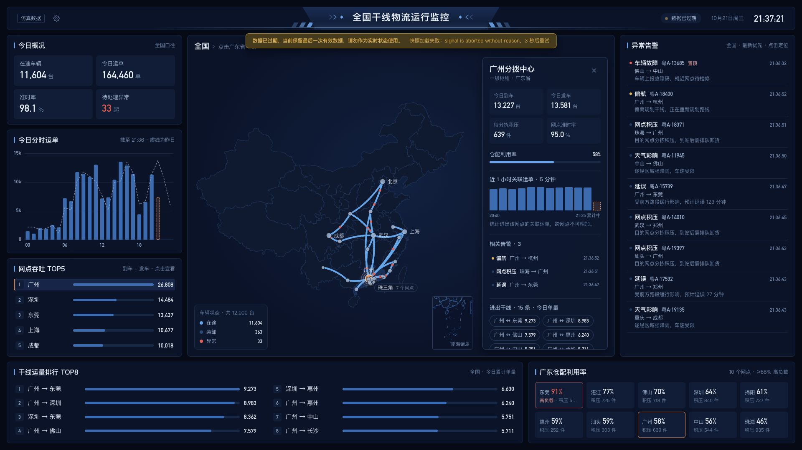

# 项目全面走查与迭代建议

日期：2026-10-21（Asia/Shanghai）

代码基线：`develop` / `0d357b67f77bf084e19faaa0063b2472734dd144`

## 结论

全国/广东切换、网点与事件联动、响应式布局、断线恢复已经具备可演示的基础。首轮之后又补了交互与渲染、数据演化与协议、启动部署与播控三轮检查，累计 **12 个已确认问题**：3 个交互/适配、5 个数据或指标语义、3 个启动/播控、1 个性能指标命名。没有发现有证据支持的 P0/P1 阻断问题。按项目 PC 大屏定位，优先处理数据一致性、事件完整性、启动恢复、桌面交互、地图性能与长期播控稳定性；手机专属问题延期，不阻塞 PC 版本验收。

下一阶段建议将项目定位为“干线运行监控与异常处置演示”，先把口径、异常闭环和时效逻辑做完整，不扩张成完整 TMS/WMS。以下业务方案是结合官方资料提出的项目建议，不代表所有物流企业统一采用这些流程。

本轮只新增此报告和问题截图，未修改业务代码、未引入依赖。缺陷、风险、业务增强分别记录；“未发现”不代表已经证明生产环境没有问题。

## 1. 走查范围与证据边界

### 产品定位与验收优先级

本项目以 PC 大屏为主，按 2026-10-21 确认的产品优先级安排后续工作：

- 主要验收：1920×1080、2560×1440、3840×2160；同时覆盖 PC 宽屏及拼接屏的布局、清晰度、远距离可读性和图表像素预算。真实拼接设备仍需现场验收。
- PC 兼容：1366×768、1440×900 以及窗口调整时的布局与点击坐标；鼠标、键盘、全屏、轮播、断线恢复和持续运行是主线。
- 低优先级：手机、平板等小屏适配。保留已发现的问题与证据，作为延期清单，不将移动端完整体验设为当前 PC 版本发布门槛，也不为小屏重构牺牲 PC 布局或性能。
- 分类按影响而非设备名称：数据、协议或共享代码问题即使在小屏测试中发现，只要影响 PC，仍按 PC 主线处理；专属触摸/移动导航能力按实际现场需求再提升优先级。

### 环境与方法

- Apple M1 Pro / macOS arm64，应用内 Chromium 浏览器；未取得具体浏览器版本。
- 独立启动审计引擎 `8799` 和前端 `127.0.0.1:5190`，没有停用原有开发服务。首轮性能样本来自开发模式；追加轮次使用同基线的现有生产构建 `vite preview` 检查交互/故障恢复，未重新构建，也未据此给出生产加载基准。
- 浏览器实际点击、键盘操作、截图与 DOM 几何/命中检查；服务端和消息入口代码阅读；隔离时钟/状态输入复现；HTTP/WS 实际采样。
- 正常路径之外，检查了服务中断与恢复、空位置增量、非法状态、午夜切日、装卸到发车的转换。
- 执行一次 `npm run build`、`node --test server/test/metrics.test.js`、`git diff --check`：构建成功、现有 3 项测试通过、空白检查通过。

### 本轮未覆盖

Chrome DevTools MCP 未配置，正式性能追踪暂停；没有 Lighthouse/Core Web Vitals、GPU 追踪或生产环境加载分数。没有真实 Chrome 87、低配 LED/安卓播控盒、触摸硬件、真实双屏 DPR 切换、设备实际息屏/锁屏、24–72 小时老化、并发压力和进程崩溃恢复测试。追加轮次只确认当前浏览器成功申请防息屏，不据此保证播控硬件长期持锁。

尝试设置 `5760×1080` 时，浏览器实际可测宽度被限制为 `4096`，所以只记录 `4096×1080` 的拼缝安全区布局，**不把它写成三块 1920 屏幕的现场验收**。README 中原有历史验收不等同于本轮重新验证。

### 稳定布局检查

以下结果在 resize 防抖和布局稳定后读取；不把切换瞬间的旧尺寸计为缺陷。

| 视口 | 本轮结果 |
| --- | --- |
| 1920×1080、1440×900、1366×768 | 页面宽高匹配视口；排行未横向溢出；告警按整行显示 |
| 2560×1440、3440×1440 | 页面铺满，缩放约 1.333；未发现稳定横向溢出 |
| 3840×2160 | 页面铺满，缩放 2；地图和趋势图画布 backing size 随视觉尺寸提高 |
| 4096×1080，`seams=33.333,66.667` | 三块安全区布局生效，告警完整、排行未溢出；不等同真实拼接屏验收 |
| 1080×1920 | 纵向布局，地图置顶，页面宽度匹配 |
| 390×844 | 单列纵向滚动正常；发现菜单遮挡、抽屉和地图重叠问题，见 U1/U2 |

### 已通过的交互与已有修复

- 全国珠三角入口/广东下钻、返回全国；点击网点、TOP5、仓配方块、事件流可联动。
- 详情进出干线默认 TOP6，展开/收起及关联跳转可用。
- 点击空白关闭详情；Esc 先关闭详情，再从广东返回全国。
- H 开关 HUD；F 后菜单显示“退出全屏”，退出后恢复“进入全屏”。实际播控设备仍需验收。
- 轮播在人工操作后暂停，空闲 30 秒后恢复，并能切换广东和网点；检查后已关闭。
- 手机端点击 TOP5 会滚动到地图，原先“选中了但看不到地图”的问题没有复现。
- 受控停止引擎后显示“数据已过期，当前保留最后一次有效数据”；恢复引擎后自动重拉快照、恢复实时，提示消失。此过程中快照代理 HTTP 500 日志属于主动故障注入，不计为正常路径错误。
- 地图 resize 后重算布局、事件 routeIndex 的有限整数与边界校验、引擎代际变化时严重告警高亮状态重置均已存在，不重复列为未修复问题。
- 正常走查期间未读取到控制台 error/warn；这不覆盖故障注入和所有异常路径。

## 2. 已确认问题

优先级按 PC 大屏这一产品范围排列：P2 = 主线应修复的功能/正确性问题；P3 = 当前阶段低优先级，包括打磨项和小屏专属问题。U1/U2 的复现事实保留，只调整排期，不代表问题已经修复。本轮没有据此宣称需要紧急重构。

### U1 · P3 延期 · 手机设置菜单被地图面包屑盖住，按钮点击被拦截

位置：`client/src/components/TopBar.vue:80`、`DisplayControls.vue:56`、`MapChart.vue:505`。

390×844 下打开设置，菜单的“轮播”按钮中点约为 `(168, 137.5)`。DOM 命中的是地图面包屑 `SPAN.hint`，不是按钮；点击后 `aria-pressed` 仍为 false。桌面上相同按钮能够打开轮播，排除轮播状态逻辑本身失效。

菜单虽写 `z-index:100`，仍被顶栏 `.side` 的 `z-index:2` 层叠上下文限制，地图面包屑在更高层覆盖。截图中连接状态也压在菜单上。

建议：为弹出层建立顶层容器（例如 Teleport/合适的 popover），或统一提升正确的顶栏层叠上下文；不要只继续增大子元素 z-index。同步处理 Esc、点外关闭及关闭后的焦点返回。

延期项验收：390/768 宽度下，逐个按钮与 select 的中心和边缘均能命中自身；菜单不被地图、状态条、抽屉覆盖；键盘可以完整操作。若后续修改共享弹层代码，仍须回归 1366/1920 及更大 PC 视口，不把当前手机复现外推为 PC 已失效。



### U2 · P3 延期 · 手机详情抽屉遮住网点，南海小图被挤出可视区域

位置：`client/src/components/MapChart.vue:153`、`:539`；`client/src/components/HubDetail.vue:114`、`:127`。

390×844 下，地图实际宽约 374px，而抽屉宽 300px，覆盖地图大部分可用区。当前 `max(w*0.4, w-340)` 仍保留约 40% 作为地图布局宽度，并不保证落点在抽屉外。独立几何复现中，广州和北京落点均在抽屉覆盖范围。南海小图固定向左移动后，DOM 左边界约为 -55px，已越出视口。

建议：窄屏使用地图下方详情、可折叠 bottom sheet，或真正上下分区；宽屏才采用右侧抽屉。小图、图例和抽屉按同一可用区域布局，不能各自写固定偏移。

延期项验收：在手机视口选广州、北京以及广东不同方位网点，焦点落点仍可见；抽屉内能访问全部内容；图例/南海小图不被裁；关闭后地图恢复。移动端不仅检查“无横向溢出”，还检查“关键对象未遮挡”；PC 继续沿用大屏抽屉布局，不以移动端 bottom sheet 替代。



### U3 · P2 · 全国到广东缺少确定的键盘入口

位置：`client/src/components/MapChart.vue:383`、`:458`。

全国视图的“点击广东省下钻”是普通文字，实际入口只绑定 canvas 地图点击。Tab 可以到达列表及广东视图的返回按钮，但不能聚焦这段全国下钻提示并执行对应操作。通过偶然出现的广东事件间接进入不等同于完整键盘入口。

建议：将提示改为真实按钮，保留地图鼠标入口；为地图增加简明范围/焦点说明。后续用可搜索网点列表补足不在 TOP5 的网点访问，不要求对每个 canvas 点实现复杂 Tab 导航。

验收：不使用鼠标，从全国进入广东、打开任意网点、关闭详情、返回全国都能完成；焦点可见，提示使用真实可访问名称。

### D1 · P2 · 装卸未结束就计入“今日发车”

位置：`server/src/engine.js:177`；真实装卸结束分支在 `:132`。

车辆到站后先将 arrivals、departures 各加一，随后仍有 30% 概率进入 DWELL；真正 DWELL→EN_ROUTE 时没有再记发车。隔离复现：进入 DWELL 时到车 +1、发车 +1，装卸结束时新增发车为 0。按当前“装卸/在途/今日发车”命名，这是把未离站计成已发车，午夜附近也可能归错日期。

建议：到站只记到车；立即继续行驶分支当次记发车；进入装卸的车辆在实际离站时记发车，并明确保存所属网点。若本意是“下一程已分配”，应改指标名而不是称为发车。

验收：到站→装卸→离站全过程发车只加一次；连续运行与跨日都满足这一点；TOP5 吞吐与详情使用同一口径。

### D2 · P2 · 午夜后新旧页面的未恢复异常记录不一致

位置：`server/src/engine.js:122`；客户端保留逻辑在 `client/src/stores/dashboard.ts:195`。

切日清空服务端 events/history，但没有清除车辆 ANOMALY 状态。隔离时钟复现：23:59:59 `pending=1/events=1`，00:00:01 `pending=1/events=0`。这时刷新或新打开页面可能看到异常 KPI，却取不到对应事件。

注意：已打开页面通过 mergeEvents 可能仍保留旧记录，不是所有客户端在午夜一起清空。实际影响是新旧客户端不一致，且服务端无法重新提供仍未恢复的记录；当前仿真异常一般在其 20–90 秒持续时间结束后恢复。

建议：区分“按日累计”与“活动异常”。日切只重置当天累计；活动异常保留至恢复，历史按绝对时间保留/淘汰。事件补充 `occurredAt`、恢复时间和状态，不只保存 HH:mm:ss。

验收：午夜前后两个客户端（一个持续在线，一个刚刷新）对活动异常一致；已恢复历史仍按规则可查；无重复、无跨代引擎旧事件混入。

### D3 · P2 · 空位置增量和非法状态可被当作有效数据

位置：`client/src/services/socket.ts:96`、`:81`（车辆），`:78/:94`（时间）；`client/src/stores/dashboard.ts:155`；`client/src/components/TrendChart.vue:13`。

增量位置只检查长度能被 3 整除，`vehicles:[]` 也能通过；快照检查有限数字，却未检查状态枚举，状态 99 仍可通过。隔离输入后出现 `dataStatus=ready / vehicleCount=12000 / actualPositions=0`。追加复核还发现 `ts=1e300` 是有限数字，能通过校验，却使 `TrendChart.vue:13` 的 Intl 日期格式化抛 RangeError；不能据此断言整个页面必崩，后续正常帧可能恢复趋势。这些需要损坏或不合语义的数据帧触发，不是当前引擎正常生成了这些值。

建议：当前协议实际每次传完整位置表，必须校验 `triples === vehicleCount`、状态枚举、经纬度范围、有效日期及关键字段的业务范围；已有 hubs 等字段类型检查应保留，不必重复实现。整包原子接收，失败保留最后有效数据并明确提示；若未来要支持真正稀疏 delta，应另加 ID/版本协议，不能把短数组直接解释成全表。

验收：空表、数量不符、非法状态、越界坐标、坏网点、非有限值、有限但超出 Date 范围的时间均拒绝；不刷新 receivedAt、不清空地图；错误可见且后续有效帧能恢复。

### D4 · P2 · 同一线路累计同时被解释成单向和双向

位置：`server/src/engine.js:212`、`:222`；`server/src/metrics.js:32`。

累计只有 ROUTES 下标，没有方向维度；详情用 A↔B 展示，排行却用 A→B。这不是总和计算错误，而是 UI 赋予了数据并不存在的单向语义，不能据此声称某方向运量是多少。

建议：近期统一为双向线路量（↔）；若产品需要 OD 单向排行，再明确 from/to 方向分桶，同一运单在各运输段的计数规则另行定义。

验收：同一线路在排行、详情、事件引用中名称和单位不冲突；单向方案需要对反向流量分别断言，而非仅改箭头。

### D5 · P2 · 快照与 WS 订阅之间存在漏事件空窗

位置：`client/src/services/socket.ts:179`；`server/src/index.js:67`；`server/src/engine.js:265`。

首轮 R1 只记录慢客户端事件补偿风险，追加复核证明正常接入也存在空窗：客户端先取 HTTP 快照，之后才建立 WS；若已有客户端在线，服务端会在这个间隙广播并清空全局待推事件。

用实际引擎方法构造确定性交错，输出如下：

```text
事件 1 → 新客户端快照 → 事件 2 → 老客户端广播 → 新客户端首条 delta
snapshot=[1]
existingClientBroadcast=[1,2]
newcomerFirstDelta=[]
missingFromNewcomer=[2]
recoverableInFreshSnapshot=[2,1]
```

位置/KPI 每秒整表发送，后续帧能恢复其最新状态；事件不会因为下一帧到来自动补回。正常推送期间客户端也没有 README 所写的周期快照，因此这不是单纯“晚一秒到”的问题。这里验证的是实际方法的确定性交错，不是已经用真实慢网络抓到了丢包。

建议：快照返回事件游标，订阅携带游标并补收；或先建订阅缓存，再以快照游标合并。包含 engineId 的稳定事件标识用于去重；超过保留窗口要提示历史不完整。慢客户端背压策略也应使用同一补偿机制，不能只依赖下次最新状态覆盖。

验收：在快照响应与 WS 接入之间插入事件、模拟慢客户端跳包及断线恢复后，两个客户端事件集合最终一致；重复补发不重复显示，超窗口明确降级。原 R1 在此升级为已确认问题，不重复计数。

### O1 · P2 · 引擎端口冲突后不退出，形成假启动

位置：`server/src/index.js:88`；仍保持运行的 interval 位于 `:60/:65/:80`。

server 的 error 处理只写日志。EADDRINUSE 后虽然没有监听成功，3 个定时器仍维持进程存活，一键开发入口收不到子进程退出。前端可能仍能打开，甚至因同端口原有服务而连接到另一个引擎。

内存隔离验证：向实际注册的 server error handler 发送 EADDRINUSE 后，仅有日志；退出调用为 0 次、已注册 interval 为 3 个。未抢占用户端口或实际杀掉原有服务。

建议：区分启动失败与连接级可恢复错误；监听失败时清理 timer/WS 等资源，非零退出并保留明确错误。需要端口自动换号时必须显式同步给前端，不能静默连接其他服务。

验收：占用目标端口后再启动，命令能快速非零结束，不留下持续仿真的无监听引擎；日志指出端口与原因，已有服务不受影响。

### O2 · P2 · 一键启动器吞掉子进程失败退出码

位置：`scripts/dev.mjs:7`、`:18`。

任一子进程退出后统一走 shutdown，最后 `process.exit(0)`。内存 VM 中令引擎子进程以 1 退出，主进程记录为 `[0]`；这会让脚本/CI/调用者误以为启动成功。它与 O1 是不同的错误处理缺口：即使引擎正确失败退出，父进程也仍会吞错。

建议：区分用户正常停止与子进程异常退出，保留失败码，并等待其他子进程完成终止；spawn error 也纳入处理。后代进程清理尚未实测，不据此断言存在孤儿进程。

验收：子进程返回非零、启动命令不存在、正常 Ctrl+C 三类路径可区分；异常路径的父进程必须非零退出，本次启动子进程占用的端口释放，已有其他服务不受影响。

### O3 · P2 · 配置的定时刷新在同一分钟可能触发两次

位置：`client/src/services/useDisplayRuntime.ts:14`、`:74`。

`refreshedDay` 只在页面内存。显式启用 `?kiosk=1&refresh=03:00`，页面在 03:00:00 空闲满足条件而刷新；新页面清空 refreshedDay，03:00:31 再次空闲超过 30 秒，仍处于 03:00，又满足刷新条件。虚拟时钟跨两次 hook 创建复现的触发偏移为 `[0, 31000]`。

这是同一目标分钟两次刷新，不是无限循环；仅影响显式配置刷新参数的播控模式。

建议：刷新前将设备本地日期+目标时间写入 sessionStorage 等跨刷新存储，处理存储不可用情况，或同样跨刷新持久化下一次触发时刻。保留“有人操作/数据不新鲜时不刷新”的条件。

验收：连续跨过目标分钟只刷新一次；同一 tab 刷新后不二次触发；次日仍能触发；存储被禁用时有安全降级，不抛未处理错误。

### H1 · P3 · HUD 的“平均帧耗时”实际上是平均帧间隔

位置：`client/src/services/usePerformance.ts:18`；`client/src/components/Hud.vue:13`。

`elapsed/count` 是 rAF 回调间隔的平均值，包含刷新率与等待，不是 ECharts 绘制 CPU 时间或 GPU 完成时间。120Hz 环境下约 8.5ms，即使真实计算很轻也会如此，不能把它当成单帧渲染成本。

建议：改为“平均帧间隔”；另采集接收、JSON 解析、车辆分组和图表提交的耗时。同步 setOption 耗时也不等于 GPU 完成时间，命名需区分。

验收：HUD 口径和 README 一致，不再用该值论证 GPU/绘制只花了多少毫秒。

## 3. 设计风险与待验证项

以下不是本轮已观测到的线上故障，不与上节缺陷混算。

| ID | 风险与代码证据 | 推荐方向与验收 |
| --- | --- | --- |
| R1（已升级） | 正常接入期间也存在快照→订阅空窗的确定性复现，已升级为 D5；不再只当作慢客户端待测风险。 | 见 D5，不重复计数。真实慢网络压测仍需覆盖同一补偿方案。 |
| R2 | `socket.ts:126` 没有应用层 WS 握手期限；`:203` 的看门狗只看 connected。隔离停滞握手不触发应用重试，真实浏览器原生超时未测。 | 给连接建立单独设截止时间，过期关闭旧 socket 并退避重试；同时验证停滞握手、断流、失败快照和恢复，避免重连风暴。 |
| R3 | `dashboard.ts:145/:167` 对可选 trendYesterday 只在有值时赋值；`:187` 切代引擎不清此字段。当前服务总是发送，兼容旧服务/缺字段时才有混用风险。 | 明确协议版本及字段可选性；新快照/新代际缺失的对照数据清空，不继续展示上一代引擎值。 |
| R4 | `useScreenScale.ts:58` 在旧 zoom 语义检测命中时，全局替换 Element.prototype.getBoundingClientRect，未恢复。本轮没测真实 Chrome 87。 | 收窄修正范围或提供可恢复封装，补旧内核 zoom+滚动+弹层+鼠标点击矩阵，不仅看静态截图。 |
| R5 | 现有自动降档和清理代码存在，但本轮没有长期堆内存趋势、弱 GPU、标签页休眠、系统释放 Wake Lock 后重获、真实午夜自动刷新或多客户端压测结论。 | 在目标设备跑 24–72 小时，持续记录 FPS/长任务/堆/连接数/恢复次数，观察稳定区间而非单点；自动刷新不能代替内存泄漏定位。 |
| R6 | `server/src/index.js:15/:50/:92` 为演示服务：宽松 CORS、WS 无鉴权，监听未限制 localhost。当前数据是仿真，不据此定性为生产安全事故。 | 若对公网或接真实位置/运单数据，先做 HTTPS/WSS、身份与租户/网点授权、Origin 策略、连接及请求限流、脱敏与审计；CORS 不等于鉴权。未取得授权不接入真实业务数据。 |
| R7 | `MapChart.vue:86` 按全局下标 `i % stride` 抽样，输入排序可能与采样步长相关。隔离有效输入中令广东车全在奇数下标，广东普通在途 full=5464，balanced/low=0；装卸342、异常194均完整保留。当前引擎随机排列，未在正常页面自然观察到普通点整层消失。 | 对可见普通车辆池采样，或采用稳定哈希/空间分层；覆盖按区域/线路排序与交错排列。不要把此项误写成异常点丢失或图例计数错误。 |

一般打磨项：个别 11px 硬编码（例如南海图注）与 README 最小 12px 不一致；告警级别虽有 aria 描述，但纯视觉用户主要靠圆点颜色理解，可增加紧凑等级图例/文字选项；排行在极端大数值下建议统一紧凑数字格式，不能把“省略兜底”当成任意长度均可读的保证。这些建议需结合实际字号与信息密度选择，不必全部增加常驻文案。

## 4. 地图与链路性能记录

### 本机实测

| 项目 | 本轮样本 | 如何解读 |
| --- | --- | --- |
| 全国 1920×1080 | HUD 约 117–118 FPS；12,000 个点；full/DPR 1；帧间隔约 8.5ms；推送延迟约 8–11ms | 本机、短时、开发环境；FPS 不等于图表 CPU/GPU 成本 |
| 全国 3840×2160 | HUD 样本约 118 FPS；12,000 个点；zoom 2 / DPR 2 | 未复现简单把 1920 画布拉伸到 4K 的问题；不能外推低配播控盒 |
| 4K 像素核对 | 主图逻辑宽约 1022，视觉宽 2044，canvas backing 宽 2044；趋势图逻辑宽 386，视觉/backing 宽均约 772 | 这里设备 DPR 为 1；高 DPR 屏仍需现场验证 |
| HTTP 快照 | HTTP 200、gzip，单次线上响应体 81,541 bytes（约 79.6 KiB） | 一次样本，不是固定包大小或并发容量 |
| WS 10 条增量 | 平均解压 JSON 210,468 bytes（约 205.5 KiB）；底层读入增量平均 78,729 bytes（约 76.9 KiB/条），permessage-deflate 生效 | 1Hz 时约 76.9 KiB/s/客户端；读入含少量协议/握手开销。HUD 已明确显示“解压后”，不应再当成真实带宽缺陷 |
| 构建产物 | 主 JS 1,143.14 kB / gzip 372.81 kB；广东异步块 194.03 kB / gzip 65.02 kB；CSS 31.51 kB / gzip 5.91 kB | 构建工具十进制单位；需要生产首屏追踪后才决定是否进一步拆包 |

### 最值得继续测的性能成本

1. **画布像素预算，不只看点数。** 首轮无焦点样本主图观察到 7 个 canvas 层，追加轮次联动后样本为 8 层，层数会随交互状态变化。仍按首轮 7 层、逻辑约 1022×770、zoom 2 计算：设备 DPR 1 时最终 canvas DPR 2，每层 RGBA 约 12 MiB，7 层约 84 MiB；设备 DPR 2 时最终 DPR 4，7 层约 336 MiB。这是 `宽×高×DPR²×4` 的存储估算，不是测得 GPU 显存，未含回缓冲等开销。先核对可合并的 zlevel、空图层，再设目标设备像素预算。
2. **DPR/画质切换的瞬时重建。** useEcharts 会恢复旧 getOption，MapChart 随后完整重建并渐进喂点，存在重复提交机会。先追踪次数/长任务，再决定是否由地图独占恢复流程；未量化前不承诺提速比例。
3. **接收与绘制分开测。** 建议记录 decode/parse、分组过滤、setOption 提交、帧间隔 p50/p95、长任务、实际绘制数与降档原因。同步提交结束不意味着 GPU 已完成。
4. **前后端容量一起测。** 每客户端约 77 KiB/s 是本轮样本，100 个客户端粗算仅数据就约 7.5 MiB/s；这只是线性带宽估算，不是 100 并发能力证明。逐连接压缩、同步 gzip 快照和事件补偿都应纳入负载测试。
5. **优化不丢业务重点。** 验收低档位保留全部异常/装卸点，普通在途点可采样；提示渲染数和降档原因。弱设备若不能维持 30 FPS，再调整流线、DPR、点数，不预设硬件必定能达标。

## 5. 行业业务逻辑与适合本项目的增强

### 先明确产品范围

建议服务三类查看者：值班调度看异常与影响、区域负责人看网点负载与延误、展示场景看运行规模。主线应是“发现异常 → 定位 → 看影响 → 处理 → 恢复/关闭”，而不是继续堆图表。保持仿真标识，不把城市弧线叫真实道路轨迹，不把事件发生位置叫当前车辆追踪。

### 可以借鉴的官方做法

- Oracle OTM 的跟踪事件可关联运输对象/站点，并记录状态、原因、责任方、地点、发生时间。可借鉴这些字段组织事件详情；不需要照搬其全部后台流程。[Oracle：Add Shipment Tracking Event](https://docs.oracle.com/en/cloud/saas/transportation/25c/otmol/execution/25_shipment_status/add_shipment_tracking_event.htm)
- GS1 EPCIS 区分业务发生时间 eventTime 与 EPCIS 事件库记录时间 recordTime，并定义事件标识。项目可借鉴这种时间分层，另行记录前端“接收于”，支持去重与补收；前端接收时间不直接等同于 recordTime，当前协议也不因此成为 EPCIS 实现。[GS1 EPCIS 标准，7.4.1](https://ref.gs1.org/standards/epcis/2.0.1/)
- SAP 的货运订单流程将运输需求/货运单元分配到货运订单，而不是把车辆直接等同于运单。适合借鉴对象分层，不直接套用其企业级实现。引用材料较早，只用于稳定的对象关系参考。[SAP：Managing Freight Orders](https://help.sap.com/doc/e8bbbe07971c4577ab801be231931950/9.1/en-US/PD_91_Managing_Freight_Orders.pdf)
- DHL 官方追踪资料列出轨迹、预计到达及关键节点，同时说明信息随服务可用性不同，API 也有订阅密钥等条件。因此真实 ETA/轨迹必须有授权数据源，不能由目前的贝塞尔动画推导。[DHL Tracking API](https://developer.dhl.com/tracking?lang=zh-hans&language_content_entity=en)

### A. 不接真实系统也能先做

1. **指标字典。** 为每项写清对象、单位、范围、时间窗、更新时刻、计算规则和模拟来源。当前 pendingAnomalies 实际是异常车辆数，不是工单待办，建议先称“异常车辆/台”；准时率、仓配利用率缺少真实分子分母时，要说明是仿真指标，不伪造 SLA。
2. **可追溯事件。** 最小增加 eventId、vehicleId、tripId/routeId、occurredAt、receivedAt、source、status、reason；详情同时标注发生位置及发生时间。历史回放与当前活动告警分开展示。
3. **轻量筛选。** 严重度、类型、网点、线路及一键清除筛选；选中事件后关联列表和地图同步，给出“仅筛选告警/不改变全国 KPI”的范围说明。保留无人值守轮播与人工优先，不新增一排常驻操作条。

### B. 扩展仿真引擎后再做

4. **最小运输对象模型。** Route 表示网络连接，Trip 表示一次执行，Vehicle 绑定执行，Waybill 表示托运业务；一车可承载多单，一单可经过多段。先做小样本关联详情，不立刻为 12,000 个动画点建立复杂订单后台；样本指标与全网 KPI 分开标注，或建立可核对映射，不把样本覆盖率当全量覆盖。结算、计费、承运合同暂不纳入。
5. **时效与 ETA。** 增加计划发车/到达、预计到达、实际到达、承诺时间窗；用可解释规则生成仿真 ETA，再计算到达准时率。必须定义未到达但已逾期如何计算、取消/零分母如何处理。同期涨跌率/累计对比使用相同已流逝时间；独立标注的昨日完整分时参考线不必截断。不要把动画加速时间当真实运输时钟。
6. **异常处置闭环。** 建议状态为新建→确认→处理中→已恢复/已关闭，记录责任人、影响运单量、持续时间、处置说明；车辆恢复和工单关闭是两个维度。这是拟议项目流程，不是行业统一标准。
7. **容量与网点作业。** 先选定“库容占用/面积/体积”或“作业负荷”之一，写清容量与使用量；车辆重量利用率和体积利用率分开。运输网点可先加入排队车辆、等待时长、小时处理能力，比随机百分比更能支持调度解释。当前 88% 高负载、积压阈值等均视为可配置演示规则，不声称行业通用阈值。

### C. 需要真实数据与额外授权

真实车载定位、道路轨迹、路况 ETA、签收凭证、承运商 SLA、WMS 库存和容量都需要明确合法来源、使用授权/内部权限、隐私与质量要求，外部合同按来源需要确认。本轮未接第三方账户、未上传项目业务数据、未新增地图 SDK 或付费服务。没有数据源时保持仿真闭环，不做“看似真实”的推断。

### 实施前需要确认的口径

- 今日运单是创建、发运、到达还是签收？统计唯一运单还是运输段次数？
- 准时率按车辆、趟次还是运单？分母、逾期未完成、取消和零分母规则是什么？
- “待处理”指异常车辆、异常事件还是人工处置单？跨日如何保留？
- “仓配利用率”具体占用了什么容量？广东下钻要区域口径还是继续明确全国口径？

## 6. 建议迭代顺序与验收门槛

按 PC 大屏优先组织阶段，每阶段按独立改动提交，先确定业务口径再改引擎；不把所有增强混在一个大提交中。12 个确认项中，10 个属于 PC 主线或共享能力，2 个手机专属项延期；这不是修复完成状态。

| 阶段 | 范围 | 完成标准 |
| --- | --- | --- |
| 1. 数据与启动可靠性 | D1–D5、O1–O3；配合日切、状态转换、协议拒收、事件补偿及启动失败回归用例 | 8 个确认项逐条复验；异常输入不污染状态；新旧客户端活动异常一致；事件从首次接入到重连不重不漏（超窗口明确提示）；启动失败能被正确识别 |
| 2. PC 交互与地图性能 | U3、H1；鼠标/键盘联动、桌面抽屉、全屏/轮播、2K/4K 清晰度、DPR/画质与图层预算、R7 采样排序 | 另外 2 个 PC 确认项复验；主要 PC 视口无关键遮挡；快捷键/焦点/定位一致；降档保留关键状态，性能指标口径明确 |
| 3. PC 目标硬件验收 | 生产构建、正式性能追踪、真实 4K/旧内核/宽屏及拼接、24–72h 老化与网络故障；现场有触摸需求时再专项覆盖 | 建立设备基线和 p95；验证画布像素与点击坐标、降档稳定性；无持续堆增长、连接堆积和恢复后不一致。不能以手机未完善阻塞此阶段 |
| 4. 运输场景与业务闭环 | 指标字典、绝对事件时间、活动/历史区分、最小处置状态、小样本 Trip/Waybill、里程碑、可解释 ETA、容量与筛选 | 能从一个告警追到相关运输段、受影响业务和恢复过程；指标可解释；所有比例有分子/分母/时间范围 |
| 延期. 小屏适配 | U1/U2；手机/平板的菜单、详情呈现与触摸交互 | 2 个延期确认项按需修复；修改共享能力时回归 PC，不为兼顾小屏降低大屏信息密度或渲染表现 |
| 可选. 真实接入 | 授权数据、认证授权、脱敏、监控告警、部署约束 | 数据来源可说明、接入可撤销、错误与过期可见；取得权限前不实施 |

PC 主线建议补的定向回归：装卸后离站一次计数、午夜仍有异常、损坏 delta 原子拒绝、非法日期、乱序/重复/跨代事件、快照与订阅交错、慢客户端补偿、握手停滞、端口冲突/子进程失败、同日定时刷新防重、DPR 切换后点击坐标准确、PC 菜单与抽屉、键盘下钻、轮播遇人工操作暂停。手机菜单命中和手机抽屉焦点可见保留为延期回归。现有 3 项 metrics 测试通过并不能覆盖这些场景。

## 7. 追加三轮复核记录

追加检查仍基于 `0d357b6`。下表是本轮执行范围，不把相同问题重复算作新发现；没有为文档编辑重新运行整套构建/测试。

| 轮次 | 覆盖与实际结果 | 新发现或证据更新 |
| --- | --- | --- |
| 交互与渲染 | 生产预览中 TOP5→关联网点→Esc→仓配→事件定位可用；连续 full/balanced/low/full/low/auto 切换后仍正常渲染，恢复 full+auto；减少动效时对应设置禁用；播控空闲后有 cursor-hidden，关闭后恢复；浏览器反馈防息屏申请成功。3440×1440 下 contain+seams 组合正确居中且不启用拼缝安全区。 | R7 特定输入排序采样风险；没有确认新的异步销毁/重建故障。短时采样不用于证明无内存泄漏。 |
| 数据演化与协议 | 72 小时虚拟时钟、145 次隔离采样中，今日运单 KPI=分时合计=全线路合计，日内线路不回退，未来小时为空；日期缓存淘汰再建一致，昨日值与前一天完整目标一致。隔离载入实际引擎逻辑推进 400 步（模拟 100 秒），12,000 台状态与 KPI 在途/异常计数一致；去重/倒序/60 条窗口、跨代清理、非法 routeIndex 拒绝通过。 | D5 接入竞态由风险升级；D3 增加有限但非法时间值的复现。虚拟时钟与 400 步检查不是 72 小时真实老化。 |
| 启动部署与播控 | API超时/非2xx/JSON错误路径与生产默认同域配置复核；隔离VM复现端口冲突处理、启动器失败码、定时刷新防重。只对独立审计引擎做36秒暂停/恢复，触发过期提示、15秒看门狗与快照超时，恢复后实时提示恢复且广州选择保留。 | O1、O2、O3。README:81 的“60s 快照兜底”已陈旧：实际是每5秒检查、超过15秒未更新重建连接，并非正常推送时周期补快照。 |

地图异步生命周期另做了三种隔离交错：广东懒加载挂起后返回全国、挂起后卸载、挂起后更换图表实例；旧 Promise 完成均未向过期/已销毁实例提交，`buildVersion/disposed/实例相等` 守卫有效。full/balanced/low 三档对视图内异常与装卸点保留断言通过。



本报告是当前基线的审计快照。修复后逐条更新“证据/状态/复验结果”，不要把建议列表全部勾选当成项目已经完美或达到生产级的证明。
